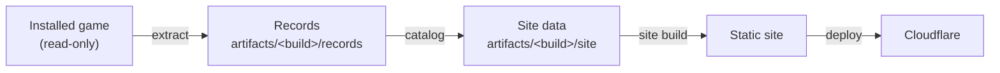

# The Bloodline Compendium

A searchable item reference for players of [The Bloodline](https://store.steampowered.com/app/1159290/The_Bloodline/), built from the game's own data. Every named inventory item has a page with its facts, its icon and the sources the game data shows. Where the data leaves something unknown, the page says so, and the coverage page lists every gap. Maps and mechanics guides follow later.

The data is read offline from the installed game. It is regenerated from the game files whenever it is needed, so extracted data never enters Git, and the published site is its only public form.



## Setup

On macOS and Linux, `nix develop` opens a shell with every tool. On Windows, install the .NET SDK version named in `global.json`, the Bun version named in `package.json` and Node.js 22.

Then restore the tools and dependencies from the repository root:

```sh
dotnet tool restore
dotnet restore --locked-mode
bun install --frozen-lockfile
bun run --cwd site playwright install chromium
```

Copy `bloodline.example.json` to `bloodline.local.json`, which Git ignores, and set `steamLibrary` to the Steam library that holds The Bloodline. Building the site with invented data needs neither the game nor this file.

## Build the data

```sh
dotnet run --project src/Bloodline -- extract
dotnet run --project src/Bloodline -- catalog
```

`extract` reads the installed build without changing it and writes records and icons to `artifacts/<Steam build ID>/records`. It takes several minutes and several gigabytes of memory, and it fails if Steam changes the game while it runs. `catalog` turns the records of the installed build into site data in `artifacts/<Steam build ID>/site`. Pass `--build <ID>` to catalog another extracted build. Each command replaces its output only after it succeeds.

## Work on the site

`bun run --cwd site dev` serves the site with invented fixtures from `site/fixtures/site-data`. To see real data, set `BLOODLINE_SITE_DATA` to the absolute path of a site data directory.

To review a full build of real data locally, run `bun run --cwd site build:preview` with `BLOODLINE_SITE_DATA` set, then `bun run --cwd site review`. This build skips only the provenance checks of a production build and never uploads anything.

The C# types in `src/Bloodline/SiteData/SiteDataModel.cs` define the site data. After changing them, run `bun run types` to regenerate the JSON Schema and TypeScript types that the site uses.

## Checks

CI runs these on invented fixtures, as listed in `.github/workflows/ci.yml`:

```sh
dotnet csharpier check . && dotnet build --no-restore && dotnet test --no-build
bun run types:check && bun run guard
bun run --cwd site lint && bun run --cwd site format:check && bun run --cwd site check
bun run --cwd site test:unit && bun run --cwd site build:fixtures && bun run --cwd site test:e2e
```

`bun run guard` fails when Git tracks game files or extracted output. `nix build --no-link .#checks.<system>.openspec` validates the OpenSpec artifacts with the check that every repository on this workstation shares. Its CLI has no Intel Mac build, so the check runs on Apple silicon Macs and Linux only.

## Publish

Publishing needs Wrangler logged in to the Cloudflare account that holds `compendiums.org` (`bunx wrangler login` in `site/`).

1. Commit your changes, then run `catalog` again, because site data records the commit it was built from.
2. Build with `BLOODLINE_SITE_DATA=<absolute path>/artifacts/<build ID>/site bun run --cwd site build`. A production build refuses uncommitted changes and site data from another commit. Only this build fills `site/.stage/production`, the directory that deployments upload, so fixture and preview builds can never be published.
3. Run `bun run --cwd site deploy:preview`. It checks the staged build, uploads it as a new version without deploying it, and smoke-tests the `staging` Version URL that Wrangler prints. Review the site there. Its pages keep their canonical links to the production domain, so search engines treat the production pages as the originals.
4. Run `bun run --cwd site deploy:production`. It repeats the checks, deploys to `bloodline.compendiums.org` and smoke-tests the live site.

`deploy:dry-run` and `deploy:preview:dry-run` run the checks and Wrangler's dry run without uploading. `bun run --cwd site deploy:smoke <origin>` smoke-tests any origin against the staged build. To roll back, list versions with `bun run --cwd site deploy:versions`, then run `bun run --cwd site deploy:rollback -- <version ID> --message "<reason>"`.

## After a game update

1. Let Steam update the game, then run `extract` and `catalog`. The previous build's output stays in `artifacts/`.
2. Compare the two builds, for example with `git diff --no-index --stat artifacts/<old>/site artifacts/<new>/site`, and read the new coverage page.
3. Fix new gaps in the code where the data allows it, then publish.
4. Delete the old build's directory once it is no longer needed. Steam keeps every build, so its data can be regenerated later.

## Troubleshooting

- A configuration error names the setting to fix and the file it read.
- If extraction reports that the installed build changed, Steam updated or verified the game during the run. Wait until Steam has finished, then run it again.
- The level `MoonhornCliffs_LocationsOfInterest` is listed as unread, because it is larger than CUE4Parse can load.
- If Playwright cannot find a browser, install Chromium as shown in Setup.

## More

`openspec/` holds the requirements and the design decisions with their reasons. `AGENTS.md` holds the rules for coding agents.

## License

MIT. See [LICENSE](LICENSE).

The Bloodline Compendium is an unofficial fan project and is not affiliated with Shieldbearer Studios or 505 Games. The Bloodline and its names, artwork and assets belong to their owners.
